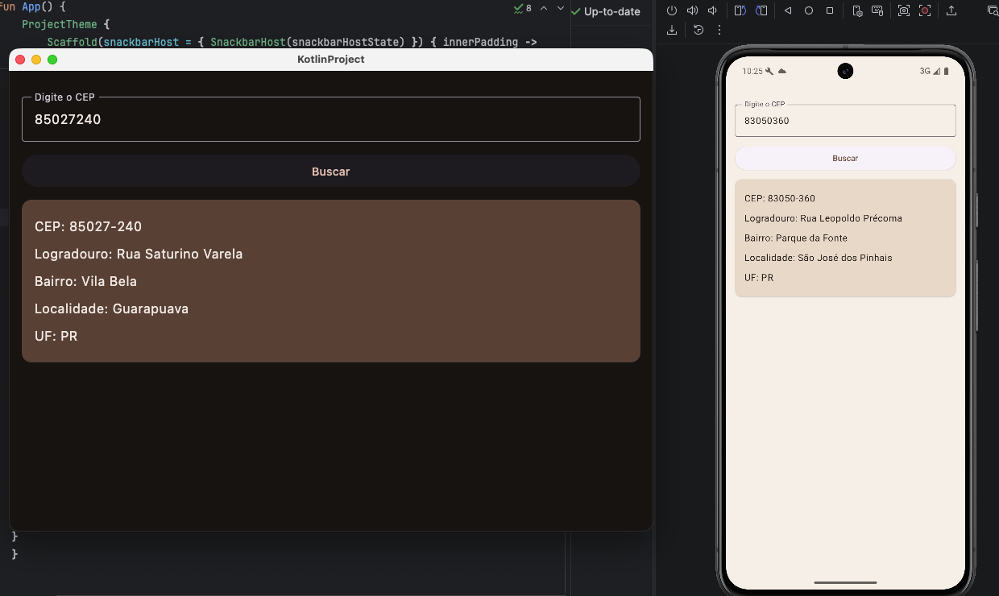

# Consulta de CEP — Kotlin Multiplatform

Aplicação desenvolvida em Kotlin Multiplatform e Compose Multiplatform para consultar endereços por CEP usando a API ViaCEP.

## Funcionalidades

- Entrada de CEP com validação de oito dígitos;
- Consulta de Logradouro, Bairro, Localidade e UF;
- Interface compartilhada entre Android e Desktop;
- Indicador de carregamento durante a consulta;
- Bloqueio do campo e do botão durante o processamento;
- Mensagens de erro usando `Snackbar`;
- Tema claro em tons de bege e marrom;
- Tema escuro com tons de marrom profundo.

## Tecnologias

- Kotlin Multiplatform;
- Compose Multiplatform;
- Ktor Client;
- Kotlin Serialization;
- Material 3;
- API [ViaCEP](https://viacep.com.br/).

## Estrutura principal

```text
shared/src/commonMain/kotlin/org/example/project/
├── data/
│   ├── model/
│   ├── remote/
│   └── repository/
├── domain/
│   ├── model/
│   └── repository/
├── ui/
│   ├── theme/
│   ├── CepUiState.kt
│   └── CepViewModel.kt
└── App.kt
```

O código em `commonMain` é compartilhado entre Android e Desktop. A camada de dados utiliza Ktor para realizar a chamada à ViaCEP, enquanto a ViewModel controla os estados da tela.

## Como executar

### Android

No Android Studio, selecione a configuração `androidApp` e execute em um emulador ou dispositivo conectado.

Pelo terminal:

```bash
./gradlew :androidApp:assembleDebug
```

### Desktop

```bash
./gradlew :desktopApp:run
```

## Exemplo de consulta

Informe um CEP com oito dígitos, como:

```text
85027240
```

A aplicação exibirá o CEP, Logradouro, Bairro, Localidade e UF retornados pela ViaCEP.

## Aplicação em execução



## Fonte da API

O projeto utiliza o endpoint:

```text
https://viacep.com.br/ws/{cep}/json
```
